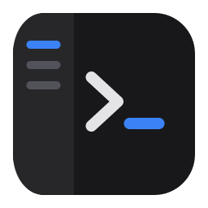
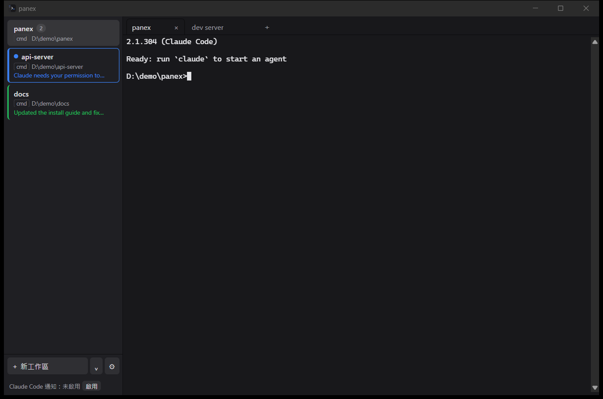
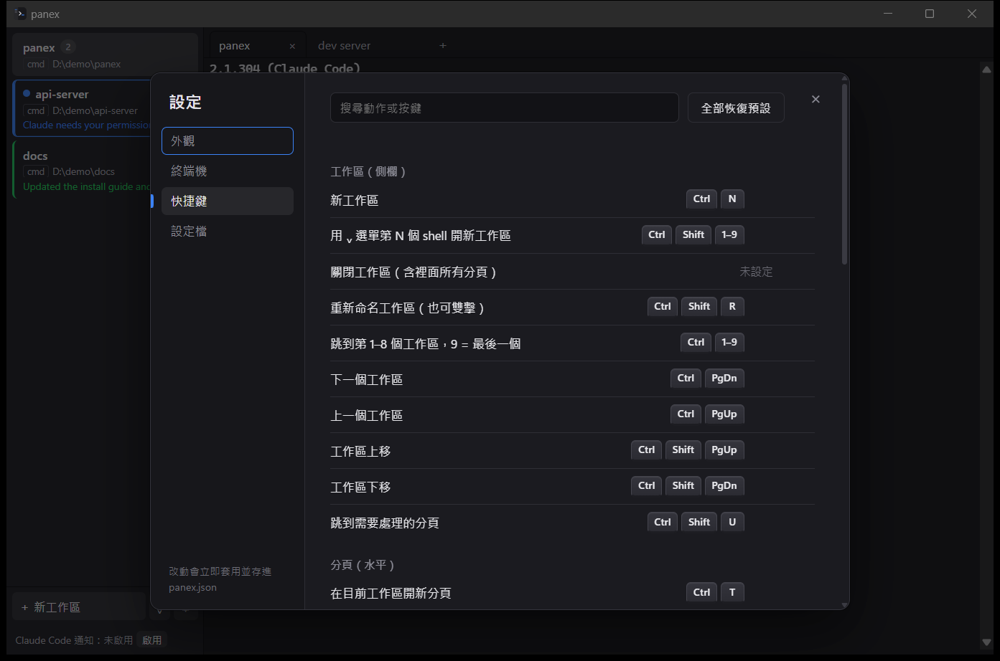

<div align="center">



# panex

**A terminal for running many AI coding agents at once — see which one needs you, and pick up where you left off after a crash.**

[](LICENSE)


[](https://github.com/firstfu/panex/releases/latest)

[Download](https://github.com/firstfu/panex/releases/latest) · [Features](#features) · [Install](#install) · [Configuration](#configuration) · [FAQ](#faq)

English · [繁體中文](translations/README.zh-Hant.md)

<a href="https://github.com/firstfu/panex/releases/latest"><b>Download panex_0.1.0_x64-setup.exe</b></a>



</div>

> [!NOTE]
> panex targets **Windows 10 and 11** first. It builds for macOS and Linux too, but those builds aren't tested yet. The installer **isn't code-signed**, so Windows SmartScreen warns on the first run: click **More info → Run anyway** ([steps](#install)). All the code is here, and panex makes [no network connections](#privacy).

## Why panex

Running three or four Claude Code sessions at once means constantly flipping between windows to find the one that's waiting for a "yes". On macOS, [cmux](https://github.com/manaflow-ai/cmux) solves this. On Windows there was nothing like it, so panex brings the same idea to Windows: a terminal that knows when an agent needs you.

It's built to stay out of the way. The app itself is a 9 MB executable that uses no CPU when idle, and closing it — or a crash — doesn't lose your layout.

## Features

### Know which agent needs you

When Claude Code asks for permission or finishes a task, its tab gets a dot and its workspace lights up in the sidebar with the message: blue when it's waiting for you, green when it's done. If panex is in the background, you also get a desktop notification and a taskbar flash. <kbd>Ctrl</kbd>+<kbd>Shift</kbd>+<kbd>U</kbd> jumps straight to the tab that needs you.

One click on **啟用** (Enable) at the bottom of the sidebar sets up the [Claude Code hooks](#claude-code-notifications). Other tools can notify too: run `panex-cli notify "message"`, or print a bell, OSC 9 or OSC 777 sequence.

### Workspaces and tabs, like cmux

The sidebar holds workspaces (<kbd>Ctrl</kbd>+<kbd>N</kbd>), one per project or task. Each workspace has its own row of tabs (<kbd>Ctrl</kbd>+<kbd>T</kbd>), and each tab is a shell that opens in the same folder as the one you were in. Rename workspaces and tabs, give workspaces a color, and drag either into order.

### Comes back after a crash

Workspaces, tabs, each tab's shell and working directory, and the scrollback text are saved as you go. Close panex, reboot, or kill it from Task Manager: next time it opens exactly where you were. Like cmux, programs that were running are not kept alive; you restart them yourself.

### Every shortcut is yours

Click a shortcut in Settings and press the new keys. Bind two combinations to one action, use chords such as <kbd>Ctrl</kbd>+<kbd>K</kbd> <kbd>Ctrl</kbd>+<kbd>N</kbd>, or unbind a key so it reaches the terminal. Conflicts are resolved for you: the old owner of a combination loses it, and you're told which one.



### And more

- **cmd by default**, Windows PowerShell and PowerShell 7 (if installed) one click away
- Transparency, plus Mica or Acrylic window backgrounds on Windows 11
- One plain JSON config file with a schema, applied the moment you save it
- Chinese and other wide characters line up correctly; Unicode 11 widths
- Ctrl+C copies when text is selected and interrupts otherwise; Ctrl+V pastes
- Single instance: opening panex again brings the existing window forward

## Performance

Measured on the release build:

| | |
|---|---|
| `panex.exe` | **9 MB** |
| Installer | **2.2 MB** |
| CPU when idle (10 s, 7 tabs) | **0.03 s total** |
| panex process memory | **≈ 7 MB** private |

Most of the memory you'll see in Task Manager belongs to WebView2, the Edge engine that draws the window (about 220 MB with 7 tabs open). Restored tabs don't start their shell until you open them, and only the visible tab uses GPU rendering.

## Privacy

panex makes **no network connections**. There's no telemetry and no update check.

The only file it writes outside its own folders is `~/.claude/settings.json`, and only when you click **啟用** to turn on Claude Code notifications. It backs the file up first (`settings.json.panex-bak`) and keeps your other hooks. The code is in [`src-tauri/src/hooks.rs`](src-tauri/src/hooks.rs).

## Install

1. Download `panex_0.1.0_x64-setup.exe` from [Releases](https://github.com/firstfu/panex/releases/latest).
2. Run it. Windows SmartScreen will warn you the first time, because the installer isn't code-signed: click **More info**, then **Run anyway**.
3. panex installs for your user only (no administrator rights needed) and adds a Start menu entry.

Requires **Windows 10 or 11** with WebView2 (already part of Windows 11 and up-to-date Windows 10).

### Updating

Run the new installer. Your workspaces, scrollback and settings are kept.

### Claude Code notifications

Click **啟用** at the bottom of the sidebar. panex adds `Notification`, `Stop` and `UserPromptSubmit` hooks that run `panex-cli notify` to `~/.claude/settings.json`. Outside panex the helper exits immediately, so Claude Code sessions in other terminals aren't affected.

## Configuration

Settings live in `%USERPROFILE%\.config\panex\panex.json` (`~/.config/panex/panex.json` on macOS and Linux), in the spirit of cmux's `cmux.json`:

- Write only the keys you want to change. Everything else uses the defaults.
- `panex.schema.json` sits next to it, so editors such as VS Code offer completion and descriptions.
- Saving the file applies it about 0.3 s later. If it doesn't parse, panex keeps the last good settings and shows the error with a button to open the file.
- The Settings panel (⚙ or <kbd>Ctrl</kbd>+<kbd>,</kbd>) writes to the same file.

```json
{
  "$schema": "./panex.schema.json",
  "schemaVersion": 2,
  "app": { "opacity": 85, "windowEffect": "acrylic" },
  "terminal": { "fontSize": 15, "defaultShell": "powershell" },
  "shortcuts": {
    "bindings": {
      "newTab": [["ctrl+t"], ["ctrl+shift+t"]],
      "renameTab": "f2",
      "nextWorkspace": ["ctrl+k", "ctrl+n"],
      "clearScrollback": null
    }
  }
}
```

A string is one combination, an array of strings is a chord, an array of arrays lists alternatives, and `null` unbinds the action.

### Default shortcuts

| Keys | Action (id) |
|---|---|
| <kbd>Ctrl</kbd>+<kbd>N</kbd> | New workspace (`newWorkspace`) |
| <kbd>Ctrl</kbd>+<kbd>T</kbd> | New tab in the current workspace (`newTab`) |
| <kbd>Ctrl</kbd>+<kbd>1</kbd>…<kbd>9</kbd> | Go to workspace 1–8, 9 = last (`selectWorkspaceByNumber`) |
| <kbd>Alt</kbd>+<kbd>1</kbd>…<kbd>9</kbd> | Go to tab 1–8, 9 = last (`selectTabByNumber`) |
| <kbd>Ctrl</kbd>+<kbd>PgDn</kbd> / <kbd>PgUp</kbd> | Next / previous workspace |
| <kbd>Ctrl</kbd>+<kbd>Tab</kbd> / <kbd>Ctrl</kbd>+<kbd>Shift</kbd>+<kbd>Tab</kbd> | Next / previous tab |
| <kbd>Ctrl</kbd>+<kbd>Shift</kbd>+<kbd>W</kbd> | Close tab; closing the last one closes its workspace (`closeTab`) |
| <kbd>Ctrl</kbd>+<kbd>Shift</kbd>+<kbd>R</kbd> / <kbd>Ctrl</kbd>+<kbd>Alt</kbd>+<kbd>R</kbd> | Rename workspace / tab (or double-click) |
| <kbd>Ctrl</kbd>+<kbd>Shift</kbd>+<kbd>U</kbd> | Jump to the tab that needs you (`jumpToUnread`) |
| <kbd>Ctrl</kbd>+<kbd>Shift</kbd>+<kbd>B</kbd> | Show / hide the sidebar |
| <kbd>Ctrl</kbd>+<kbd>=</kbd> / <kbd>-</kbd> / <kbd>0</kbd> | Font size up / down / reset (or Ctrl+wheel) |
| <kbd>Ctrl</kbd>+<kbd>,</kbd> | Settings |

The schema lists every action id.

## FAQ

<details>
<summary><b>Windows says "Windows protected your PC"</b></summary>

The installer isn't code-signed yet. Click **More info**, then **Run anyway**. You only need to do this once per version.
</details>

<details>
<summary><b>Claude Code notifications don't show up</b></summary>

Check the bottom of the sidebar says **Claude Code 通知：已啟用** (enabled). If it says 未啟用, click **啟用**. Notifications only light up tabs for Claude Code sessions started inside panex. Desktop notifications appear only while panex isn't the active window; the tab and workspace light up either way.
</details>

<details>
<summary><b>Ctrl+T, Ctrl+N or another key doesn't reach the program in my terminal</b></summary>

panex handles its shortcuts before the terminal sees them. For example, Claude Code uses Ctrl+T to toggle its todo list. If you need a key inside the terminal, open Settings → 快捷鍵 (Shortcuts) and rebind or clear the panex shortcut.
</details>

<details>
<summary><b>Where does panex keep my data?</b></summary>

Settings: `%USERPROFILE%\.config\panex\panex.json`. Layout and scrollback: `%APPDATA%\dev.panex.terminal\`. Delete either folder to start fresh.
</details>

<details>
<summary><b>How do I uninstall it?</b></summary>

Use **Settings → Apps → Installed apps → panex → Uninstall**. To remove your data too, delete the two folders above. If you turned on notifications, remove the `panex-cli` entries from `~/.claude/settings.json` (or restore `settings.json.panex-bak`).
</details>

## How it differs from similar tools

[cmux](https://github.com/manaflow-ai/cmux) is the original and does much more: splits, an embedded browser, SSH workspaces, a full CLI and socket API. If you're on a Mac, use it. panex exists because cmux is macOS-only. It copies cmux's ideas (workspaces with tabs, agent notifications, session restore, a JSON config with rebindable shortcuts), not its code. Windows Terminal is an excellent terminal, but it doesn't know when an agent is waiting for you or which tab it's in.

## Under consideration: vote with 👍

I won't build these until real people ask for them. If one matters to you, [open an issue](https://github.com/firstfu/panex/issues/new) or 👍 an existing one and tell me **how you'd use it**.

- Split panes inside a tab
- Search in the scrollback (Ctrl+Shift+F)
- Git branch and listening ports in the sidebar
- One click to create a git worktree and start an agent in it
- English interface

## Build from source

Requires Rust (stable), Node.js 20+, and on Windows the Visual Studio C++ build tools and WebView2.

```sh
git clone https://github.com/firstfu/panex.git && cd panex
npm install
cargo tauri dev     # run in development
cargo tauri build   # installer in src-tauri/target/release/bundle/
```

`cargo install tauri-cli --version "^2"` provides `cargo tauri`.

## Contributing

Free and open source, built by one person — [issues](https://github.com/firstfu/panex/issues/new) and pull requests are very welcome. Bug reports are most useful with your Windows version and the shell you were using.

## Also by the same author

[Liftoff](https://github.com/firstfu/Liftoff) — the Launchpad that macOS 26 took away, back and faster, with live window previews.
[DockLens](https://github.com/firstfu/DockLens-app) — hover a Dock icon to see live thumbnails of all of that app's windows.

## License

[MIT](LICENSE). Use it, change it, ship it; keep the copyright notice.
