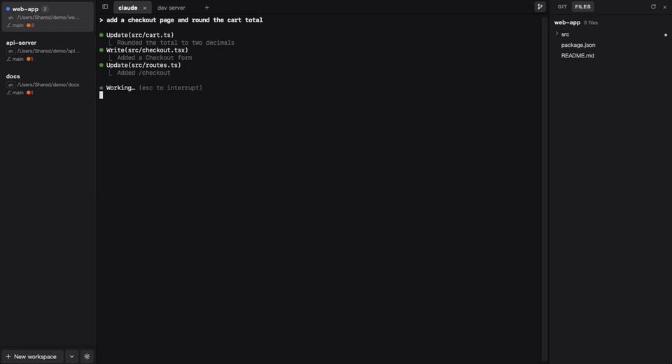

<div align="center">


# panex

**同時跑好幾個 AI coding agent 的終端機：一眼看出哪個在等你，當掉重開也能接著做。**

[](../LICENSE)


[](https://github.com/firstfu/panex/releases/latest)

[網站](https://firstfu.github.io/panex/zh/) · [下載](https://github.com/firstfu/panex/releases/latest) · [功能](#功能) · [安裝](#安裝) · [設定](#設定) · [常見問題](#常見問題)

[English](../README.md) · 繁體中文

<a href="https://github.com/firstfu/panex/releases/latest"><b>下載 Windows 版（panex_0.7.11_x64-setup.exe）</b></a> · <a href="https://github.com/firstfu/panex/releases/latest"><b>macOS 版（panex_0.7.11_aarch64.dmg）</b></a>


<br>

<a href="../assets/demo.mp4"></a>

<sub>27 秒：兩個 agent 回報狀態，再看 diff 與專案檔案。<a href="../assets/demo.mp4">高畫質影片</a></sub>

</div>

> [!NOTE]
> panex 支援 **Windows 10、11** 與 **Apple Silicon 的 macOS**（0.3.0 起；Mac 上預設快捷鍵以 ⌘ 取代 Ctrl）。Linux 能建置但還沒測試過。Windows 安裝檔沒有程式碼簽章、macOS 版沒有經過 Apple 公證，第一次執行時 SmartScreen 與 Gatekeeper 會擋（[步驟](#安裝)）。原始碼全部在這裡，而且 panex 唯一會自己連的網路是[檢查更新](#隱私)，可以關掉。

## 為什麼做 panex

同時開三、四個 Claude Code，就得一直切視窗，找哪個在等你按「yes」。panex 是一個知道 agent 什麼時候需要你的終端機。

它也盡量不佔資源。程式本體是 9 MB 的執行檔，閒置時不吃 CPU；關掉或當掉都不會弄丟你的版面。

## 功能

### 一眼看出哪個 agent 在等你

Claude Code 要求權限或完成工作時，它所在的分頁會出現圓點，側欄的工作區也會亮起並顯示訊息：藍色代表在等你，綠色代表已完成。panex 不在前景時，還會跳出桌面通知並閃爍工作列。按 <kbd>Ctrl</kbd>+<kbd>Shift</kbd>+<kbd>U</kbd> 直接跳到需要處理的分頁。agent 工作時，工作區會顯示轉圈和這一輪已經跑了多久；做完時則顯示這一輪花了多久。

panex 啟動時會自己設定好 [Claude Code hooks](#claude-code-通知)，不用另外開啟。其他工具也能發通知：執行 `panex-cli notify "訊息"`，或輸出 BEL、OSC 9、OSC 777 序列。

### 小隊模式：讓 agent 帶出其他 agent

在 panex 分頁裡請 Claude Code 把一件工作分給幾個 agent 平行處理，它會組成一個小隊：把它們開在新的工作區裡，排在它自己的下方，可以各自用一個 git worktree，在你看得到、也能直接打字的分頁裡工作。它會等它們做完；有子 agent 在等你回答時，它會告訴你是哪一個，不會替你回答；做完後再從 git 收回成果。

背後是兩個任何 agent 都能在 panex 裡執行的指令：`panex-cli open` 在新的工作區（可以加開新的 worktree）執行一個指令，不會切走你的畫面；`panex-cli wait` 會等到這些 agent 做完或需要你為止。細節見 `panex-cli help`。panex 會安裝一個小小的 Claude Code skill，教 Claude 怎麼用這兩個指令。只有在 panex 裡開出來的程序能下這些指令。

### 工作區與分頁

側欄放工作區（<kbd>Ctrl</kbd>+<kbd>N</kbd>），一個專案或一件事一個。每個工作區有自己的一排分頁（<kbd>Ctrl</kbd>+<kbd>T</kbd>），每個分頁是一個 shell，會在你目前所在的資料夾開啟。工作區和分頁都能改名、拖曳排序，工作區還能標顏色。

### 當掉重開也能接著做

工作區、分頁、每個分頁的 shell 與工作目錄、捲動歷史都會隨時存檔。關掉 panex、重開機，或從工作管理員強制結束，下次打開都會回到原本的樣子。原本在跑的程式不會保留，但 panex 會記住每個分頁正在跑的 Claude Code session：重開 panex 後打開那個分頁，會自動執行 `claude --resume <id>`，直接回到原本的對話。已經退出 Claude Code 的分頁則停在提示符。可以在 設定 → 終端機 關掉。

### 不離開終端機就能看 git 改了什麼

按 <kbd>Ctrl</kbd>+<kbd>Shift</kbd>+<kbd>G</kbd> 會在右側打開 Git 面板，顯示目前分頁所在 repo 的已暫存變更、變更與未追蹤檔案，以及最近 30 筆提交，還沒推送的會標出來。點檔案或提交，就會在終端機上方顯示 diff，按 <kbd>Esc</kbd> 關閉。側欄每個工作區的分支後面會加上 `↑` 未推送的提交、`↓` 上游較新的提交、`●` 未提交的變更，一眼就看得出哪個 agent 還留著東西沒收尾。

面板的**檔案**分頁（<kbd>Ctrl</kbd>+<kbd>Shift</kbd>+<kbd>E</kbd>）用資料夾樹列出整個專案，範圍跟 git 看到的一樣：已追蹤的檔案加上新檔案，`.gitignore` 排除的（`node_modules`、建置產物）不列。有變更的檔案標上跟 Git 分頁相同的字母，資料夾裡有變更會加一個點，不用打開就看得出 agent 動了專案的哪一塊。點檔案就在終端機上方顯示內容：Markdown 排版後顯示，程式碼有行號與語法上色，圖片（含 SVG）直接顯示。PDF、試算表、錄音這類檔案則提供**快速查看**（macOS）、**用預設 App 開啟**與**在 Finder 中顯示**。這裡只能看、不能改。文件裡的 HTML 原樣顯示成文字、圖片不載入，所以檔案不能執行任何東西，也不會連網。

面板只負責看：不會 stage、commit、push，也不會 fetch。它也不輪詢、不監看檔案，只在 shell 出現提示符、Claude Code 做完一輪，或你切回視窗時跑一次 `git status`，沒在用的時候不花任何資源。

### SSH 連線

在「新工作區」旁的 ⌄ 選單選 **SSH 連線…**，從 `~/.ssh/config` 挑一台主機，或直接輸入 `帳號@主機:埠號`，就會開成一個獨立的工作區；在那個工作區開的新分頁也會連到同一台主機。panex 用的是電腦內建的 `ssh`，所以金鑰、config、`known_hosts`、agent 都照常生效；要密碼時會在終端機裡問，panex 不會儲存。

### 每個快捷鍵都能改

在設定裡點一下快捷鍵，再按新的組合即可。一個動作可以綁兩組按鍵，也可以用連續按鍵（例如 <kbd>Ctrl</kbd>+<kbd>K</kbd> <kbd>Ctrl</kbd>+<kbd>N</kbd>），或取消綁定，讓按鍵直接送進終端機。衝突會自動處理：原本使用這組按鍵的動作會被移除，並告訴你是哪一個。


### 其他

- **預設 cmd**，Windows PowerShell 和 PowerShell 7（有裝的話）點一下就能開
- 可調透明度，Windows 11 上還能用 Mica 或 Acrylic 背景
- 單一 JSON 設定檔，附 schema，存檔即套用
- 在工作區按右鍵，可以用新的 git worktree 開一個新工作區，`.env` 等檔案會一起複製過去
- 在 worktree 的工作區按右鍵，可以關閉工作區並刪除 worktree；對話框會先列出刪掉會失去什麼（還沒 commit 的檔案、只在這個分支上的 commit、還在工作的 agent），分支要留要刪由你勾選
- 同一個 repo 在側欄排成一組：主資料夾的工作區在最上層、前面有收合箭頭，各個 worktree 縮排在它底下（標上 `worktree`）；收合時最上層那列顯示組內最緊急的狀態
- Claude Code 開 worktree 時（`EnterWorktree`、`claude --worktree`），panex 會把它建在 repo 旁邊，並在側欄 repo 底下加一個開在 worktree 裡的工作區；對話留在你原本開始的分頁。Claude 刪掉它時（`ExitWorktree`、離開 `claude --worktree`），panex 會刪掉資料夾並關掉那個工作區。用其他方式刪掉的 worktree（在終端機跑 `git worktree remove`、別的工具）也會自動從側欄消失：panex 拿回焦點或任一 shell 回到提示字元時就會發現。這是透過 Claude Code 的 `WorktreeCreate` 與 `WorktreeRemove` hook 做的，panex 外的 Claude Code 也會經過它們（那時照 Claude Code 平常的位置建立、照它平常的方式刪除）；不要的話到設定 → 終端機關掉
- 終端機裡的 emoji 是彩色的，Claude Code 狀態列的 ⚠ 之類的警告比較醒目
- 字型可以從電腦裡已安裝的等寬字型挑選，中文和 emoji 會自動用備援字型補上
- <kbd>Ctrl</kbd>+<kbd>Shift</kbd>+<kbd>F</kbd> 搜尋捲動歷史
- 按住 <kbd>Ctrl</kbd> 點網址會用瀏覽器開；點 `src/main.ts:120` 這類檔案路徑會開啟該檔案（在設定 → 終端機選了 VS Code 或 Cursor，就會直接跳到那一行）
- <kbd>Ctrl</kbd>+<kbd>Enter</kbd> 在 Claude Code 裡是換行而不是送出（可以改綁，例如改成 <kbd>Shift</kbd>+<kbd>Enter</kbd>）
- 介面有英文與繁體中文，預設跟隨系統語言（在設定裡切換）
- 中文等全形字元對齊正確，採用 Unicode 11 字寬
- 有選取文字時 Ctrl+C 是複製，沒選取時是中斷；Ctrl+V 貼上
- agent 還在工作時關閉 panex，或關掉它所在的分頁、工作區，都會先問一聲，免得誤關打斷它（可以在設定 → 終端機關掉）
- 只會開一個實例：再開一次 panex 會把原本的視窗帶到前面

## 效能

在 Windows 的 release 版上實測：

| | |
|---|---|
| `panex.exe` | **9 MB** |
| 安裝檔 | **2.3 MB** |
| 閒置 CPU（10 秒、7 個分頁） | **合計 0.03 秒** |
| panex 程序記憶體 | **約 7 MB**（私有） |

工作管理員裡看到的記憶體大多屬於 WebView2，也就是負責繪製視窗的 Edge 引擎（開 7 個分頁時約 220 MB）。還原的分頁要點開才會啟動 shell，而且只有目前看得到的分頁使用 GPU 繪製。

## 隱私

沒有任何遙測。panex 自己會連的網路只有**檢查更新**：啟動時、以及視窗取回焦點且距上次檢查超過六小時，向 GitHub 取最新 release 的 `latest.json`，除了 HTTPS 請求本身帶的東西，不會送出關於你或你電腦的資訊。到 **設定 → 一般 → 自動檢查更新**（`panex.json` 的 `app.checkForUpdates`）關掉後，panex 就完全不連網，只剩你自己開的 SSH 連線，用的是電腦內建的 `ssh`。Git 面板不會 fetch。更新不會自己安裝，而且每個下載檔都會用內建在 App 裡的公鑰驗證。

它唯一會寫到自己資料夾以外的檔案是 `~/.claude/settings.json`：panex 啟動時，如果 Claude Code hooks 還沒設定，或指向舊的安裝位置，就會把它們加進去。寫入前會先備份（`settings.json.panex-bak`），並保留你原本的其他 hooks。相關程式碼在 [`src-tauri/src/hooks.rs`](../src-tauri/src/hooks.rs)。

## 安裝

### Windows

1. 從 [Releases](https://github.com/firstfu/panex/releases/latest) 下載 `panex_0.7.11_x64-setup.exe`。
2. 執行它。因為安裝檔沒有程式碼簽章，第一次 Windows SmartScreen 會跳出警告：按 **其他資訊**，再按 **仍要執行**。
3. panex 只安裝給目前使用者（不需要系統管理員權限），並在開始選單加入捷徑。

需要 **Windows 10 或 11** 與 WebView2（Windows 11 與更新到最新的 Windows 10 都已內建）。

### macOS（Apple Silicon）

1. 從 [Releases](https://github.com/firstfu/panex/releases/latest) 下載 `panex_0.7.11_aarch64.dmg`，打開後把 **panex** 拖進「應用程式」。
2. App 沒有經過 Apple 公證，第一次開啟會被擋：先開一次，再到 **系統設定 → 隱私權與安全性** 按 **強制打開**。如果顯示「已損毀」，在終端機執行 `xattr -cr /Applications/panex.app` 後再開。

分頁會啟動你的登入 shell（`$SHELL`，通常是 zsh）。預設快捷鍵用 ⌘：⌘T 新分頁、⌘W 關分頁、⌘N 新工作區、⌘1–9／⌥1–9 跳轉、⌘↑↓ 切工作區、⌘←→ 切分頁、⌘⇧G Git 面板、⌘⇧E 檔案、⌘B 側欄、⌘, 設定。

在 macOS 看來，分頁裡跑的程式就是 panex：agent 用 `osascript` 送按鍵、用 `screencapture` 截圖時，需要「輔助使用」或「螢幕錄製」權限的是 panex。**設定 → 一般 → 權限**會列出哪些已授權，並直接打開系統設定對應的那一頁。panex 自己不需要這些權限。

### 更新

有新版時，側欄底部會出現一行提示。按 **更新並重新啟動**，panex 會下載新版、安裝並重新啟動。重新啟動會結束分頁裡正在跑的程式（有 agent 正在工作時會先問你）；工作區、捲動歷史和 Claude Code 對話都會接回。也可以到 **設定 → 一般** 手動檢查。

- **macOS**：每一版都用同一張憑證簽章，所以你授權過的輔助使用、檔案與檔案夾等權限在更新後依然有效；從 panex 內更新的版本也不必再按一次 **強制打開**。如果你原本用的是更舊的版本，第一次換到這個機制時需要最後再授權一次。
- **Windows**：安裝程式以 passive 模式執行（只有一個小小的進度視窗、不問問題），裝完自動再開 panex。
- 第一個內建更新功能的版本仍要自己安裝，跟其他版本一樣。你也隨時可以自己執行新版安裝檔，工作區、捲動歷史和設定都會保留。

### Claude Code 通知

panex 啟動時，如果 `~/.claude/settings.json` 裡還沒有執行 `panex-cli notify` 的 `Notification`、`Stop`、`StopFailure`、`UserPromptSubmit`、`SessionEnd` hooks，或它們指向舊的安裝位置，就會自動加入。寫入前會先備份，你原本的其他 hooks 都會保留。在 panex 以外執行時，這個小程式會立刻結束，所以不會影響你在其他終端機裡跑的 Claude Code。panex 也會維護 `~/.claude/skills/panex/SKILL.md`，告訴 Claude 怎麼組成小隊（見上方「小隊模式」）；這個 skill 在 panex 以外不會做任何事。

## 設定

設定存在 `%USERPROFILE%\.config\panex\panex.json`（macOS 和 Linux 是 `~/.config/panex/panex.json`）：

- 只寫你想改的鍵，其他都用預設值。
- 旁邊有 `panex.schema.json`，用 VS Code 等編輯器開啟會有自動完成和說明。
- 存檔後約 0.3 秒自動套用。如果檔案格式有錯，panex 會沿用上次正確的設定，並顯示錯誤和開啟檔案的按鈕。
- 設定面板（⚙ 或 <kbd>Ctrl</kbd>+<kbd>,</kbd>）寫的也是同一個檔案。面板有一般、外觀、終端機、快捷鍵、設定檔五頁；擋到後面想看的內容時，從左側欄按住就能拖著走。

```json
{
  "$schema": "./panex.schema.json",
  "schemaVersion": 2,
  "app": { "opacity": 85, "windowEffect": "acrylic" },
  "terminal": { "fontSize": 15, "defaultShell": "powershell" },
  "shortcuts": {
    "bindings": {
      "newTab": [["ctrl+t"], ["ctrl+shift+t"]],
      "renameTab": "f2",
      "nextWorkspace": ["ctrl+k", "ctrl+n"],
      "clearScrollback": null
    }
  }
}
```

字串是一組按鍵，字串陣列是連續按鍵，陣列裡放陣列代表多組任選一組，`null` 代表取消綁定。

### 預設快捷鍵

| 按鍵 | 動作（id） |
|---|---|
| <kbd>Ctrl</kbd>+<kbd>N</kbd> | 新工作區（`newWorkspace`） |
| <kbd>Ctrl</kbd>+<kbd>T</kbd> | 在目前工作區開新分頁（`newTab`） |
| <kbd>Ctrl</kbd>+<kbd>1</kbd>…<kbd>9</kbd> | 跳到第 1–8 個工作區，9 是最後一個（`selectWorkspaceByNumber`） |
| <kbd>Alt</kbd>+<kbd>1</kbd>…<kbd>9</kbd> | 跳到第 1–8 個分頁，9 是最後一個（`selectTabByNumber`） |
| <kbd>Ctrl</kbd>+<kbd>PgDn</kbd> / <kbd>PgUp</kbd> | 下一個／上一個工作區 |
| <kbd>Ctrl</kbd>+<kbd>Shift</kbd>+<kbd>PgUp</kbd> / <kbd>PgDn</kbd>（macOS：<kbd>⌥</kbd><kbd>⌘</kbd><kbd>↑</kbd> / <kbd>↓</kbd>） | 工作區上移／下移（`moveWorkspaceUp`、`moveWorkspaceDown`） |
| <kbd>Ctrl</kbd>+<kbd>Tab</kbd> / <kbd>Ctrl</kbd>+<kbd>Shift</kbd>+<kbd>Tab</kbd> | 下一個／上一個分頁 |
| <kbd>Ctrl</kbd>+<kbd>W</kbd> | 關閉分頁，關掉最後一個時工作區一起關（`closeTab`） |
| <kbd>Ctrl</kbd>+<kbd>Shift</kbd>+<kbd>R</kbd> / <kbd>Ctrl</kbd>+<kbd>Alt</kbd>+<kbd>R</kbd> | 重新命名工作區／分頁（也可雙擊） |
| <kbd>Ctrl</kbd>+<kbd>Shift</kbd>+<kbd>U</kbd> | 跳到需要處理的分頁（`jumpToUnread`） |
| <kbd>Ctrl</kbd>+<kbd>Alt</kbd>+<kbd>H</kbd> | 顯示／隱藏側欄（`toggleSidebar`） |
| <kbd>Ctrl</kbd>+<kbd>Shift</kbd>+<kbd>G</kbd> | 顯示／隱藏 Git 面板（`toggleGitPanel`） |
| <kbd>Ctrl</kbd>+<kbd>Shift</kbd>+<kbd>E</kbd> | 顯示／隱藏專案檔案（`toggleFilesPanel`） |
| <kbd>Ctrl</kbd>+<kbd>Shift</kbd>+<kbd>F</kbd> / <kbd>Ctrl</kbd>+<kbd>Shift</kbd>+<kbd>K</kbd> | 搜尋／清除捲動歷史（`find`、`clearScrollback`） |
| <kbd>Ctrl</kbd>+<kbd>Enter</kbd>（macOS：<kbd>Shift</kbd>+<kbd>Enter</kbd>） | 換行而不送出，給 Claude Code 用（`insertNewline`） |
| <kbd>Ctrl</kbd>+<kbd>=</kbd> / <kbd>-</kbd> / <kbd>0</kbd> | 放大／縮小／重設字型（也可 Ctrl+滾輪） |
| <kbd>Ctrl</kbd>+<kbd>,</kbd> | 設定 |

所有動作 id 都列在 schema 裡。

## 常見問題

<details>
<summary><b>Windows 顯示「Windows 已保護您的電腦」</b></summary>

安裝檔目前沒有程式碼簽章。按 **其他資訊**，再按 **仍要執行**。每個版本只需要做一次。
</details>

<details>
<summary><b>macOS 說 panex「無法打開」或「已損毀」</b></summary>

App 沒有經過 Apple 公證。到 **系統設定 → 隱私權與安全性** 按 **強制打開**，或執行 `xattr -cr /Applications/panex.app` 後再開。每個版本只需要做一次（從 panex 內更新的版本不用）。
</details>

<details>
<summary><b>更新後 macOS 權限會不見嗎？</b></summary>

不會。每一版都用同一張憑證簽章，macOS 的權限是跟著這個簽章走，而不是跟著檔案。自己從原始碼建置的版本是 ad-hoc 簽章，每次重建 macOS 都會再問一次。
</details>

<details>
<summary><b>收不到 Claude Code 通知</b></summary>

panex 啟動時會自動設定好。如果側欄底部出現 **Claude Code 通知：未啟用**，代表 panex 沒辦法寫入 `~/.claude/settings.json`（例如檔案不是正確的 JSON），把檔案修好後按一下 **啟用**。只有在 panex 裡啟動的 Claude Code 才會讓分頁亮起。桌面通知只在 panex 不是目前視窗時才會跳出，分頁和工作區則不管怎樣都會亮。
</details>

<details>
<summary><b>Ctrl+T、Ctrl+N 等按鍵送不到終端機裡的程式</b></summary>

panex 會比終端機先處理自己的快捷鍵。例如 Claude Code 用 Ctrl+T 切換待辦清單。如果某個按鍵你要在終端機裡用，到設定 → 快捷鍵，把 panex 的那組改掉或取消綁定即可。
</details>

<details>
<summary><b>跑 Claude Code、tmux 或 vim 時選不了字、複製不了</b></summary>

這些程式會開啟滑鼠回報，點擊和拖曳會送給程式，而不是用來選取。macOS 上拖曳時按住 `Option` 就能選字，再用 `⌘C` 複製；Windows 上按住 `Shift`。
</details>

<details>
<summary><b>Claude Code 的淡色提示是灰色、斜體變成直體</b></summary>

這是刻意的。用 GPU 渲染時，淡色（dim）和斜體文字後面會多出一塊黑底，所以 panex 把淡色字改畫成固定的灰色、並丟掉斜體。代價是疊在彩色字上的淡色字會變灰、斜體看起來是直的。
</details>

<details>
<summary><b>panex 把資料存在哪裡？</b></summary>

設定：`%USERPROFILE%\.config\panex\panex.json`。版面與捲動歷史：`%APPDATA%\dev.panex.terminal\`。刪掉任一個資料夾就能從頭開始。
</details>

<details>
<summary><b>怎麼解除安裝？</b></summary>

到 **設定 → 應用程式 → 已安裝的應用程式 → panex → 解除安裝**。要連資料一起刪，再刪掉上面兩個資料夾。接著把 `~/.claude/settings.json` 裡的 `panex-cli` 項目刪掉（或還原 `settings.json.panex-bak`）。
</details>

## 跟類似工具的差別

Windows Terminal 是很好的終端機，但它不知道哪個 agent 在等你，也不知道是哪個分頁。

## 考慮中：用 👍 投票

除非有人真的需要，否則我不會做這些。如果你需要其中某一項，請[開一個 issue](https://github.com/firstfu/panex/issues/new)，或在現有的 issue 按 👍，並說明**你會怎麼用**。

- 分頁內分割窗格
- 側欄顯示監聽中的 port

## 從原始碼建置

需要 Rust（stable）、Node.js 20 以上；Windows 另外需要 Visual Studio C++ 建置工具與 WebView2。

```sh
git clone https://github.com/firstfu/panex.git && cd panex
npm install
cargo tauri dev     # 開發模式執行
cargo tauri build   # 安裝檔在 src-tauri/target/release/bundle/
```

`cargo tauri` 可用 `cargo install tauri-cli --version "^2"` 安裝。

## 參與貢獻

免費、開源，由一個人開發，非常歡迎 [issue](https://github.com/firstfu/panex/issues/new) 和 pull request。回報問題時附上 Windows 版本和當時用的 shell 會最有幫助。

## 同作者的其他作品

[Liftoff](https://github.com/firstfu/Liftoff)：把 macOS 26 拿掉的 Launchpad 找回來，更快，還有即時視窗預覽。
[DockLens](https://github.com/firstfu/DockLens-app)：滑到 Dock 圖示上，就能看到那個 App 所有視窗的即時縮圖。

## 授權

[MIT](../LICENSE)。可以自由使用、修改、散布，保留版權聲明即可。
